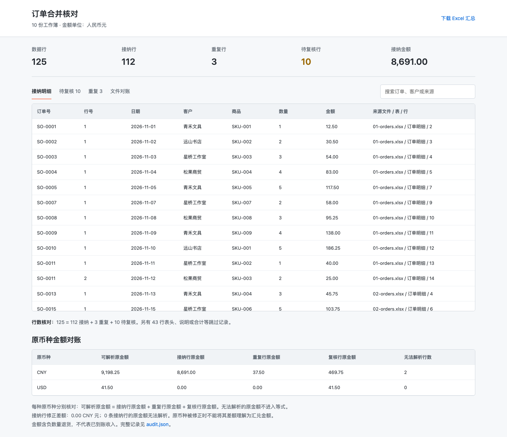

# Excel Merge Audit

[中文](README.md) · [English](README.en.md)

Turn ten inconsistent order spreadsheets into one workbook you can check against the originals. Duplicates, conflicts, missing values, and format errors stay visible. Every row keeps its source file, worksheet, and Excel row number.

I built this to answer a practical question: when someone hands over a folder of spreadsheets, can I explain which records went into the total, which did not, and why?



## The Demo

The repository includes ten synthetic workbooks. All customers and orders are fictional.

| Check | Actual result |
| --- | ---: |
| Input files | 10 |
| Data rows | 125 |
| Accepted | 112 |
| Exact duplicates | 3 |
| Needs review | 10 |
| Accepted amount (CNY) | 8,691.00 |

125 = 112 + 3 + 10. Another 43 rows are headers, blanks, notes, or totals, each with a recorded skip reason. Original amounts reconcile separately by currency. Two amounts cannot be parsed and are excluded from amount reconciliation.

- [Result workbook](demo/output/summary.xlsx): summary, accepted details, review queue, and row provenance. Sheet labels are in Chinese.
- [Offline report](demo/output/report.html): download the repository and open this file to search and switch views.
- [Full audit](demo/output/audit.json): original values, file hashes, dispositions, and issue reasons.
- [Validation record](docs/validation.md): initial version, two iterations, and checks performed.

## Run It

Requires Node.js 22 or newer. Processing stays local. No account or API key is needed.

```bash
npm ci
npm run demo -- --out outputs/first-demo
```

Open `report.html` or `summary.xlsx` in `outputs/first-demo/result/`. The demo deliberately includes errors, so a nonempty review queue is expected.

To process your own order files:

```bash
npm run merge -- --input ./my-orders --output ./outputs/run-01
```

Place `.xlsx` files in the input directory. The output directory must be empty and outside the input directory. The tool reads every worksheet in top-level input files, ignores Excel `~$` temporary files, and does not recurse into subdirectories. Original files are left untouched.

Use `--fail-on-review` in automation. The tool still exports results but exits with `2` when rows or worksheet schemas need review. Input and argument errors return `1`; a normal completion returns `0`.

## Rules

This is a CNY order-line workflow with ten required fields. Common Chinese and English aliases are supported; see [core.mjs](src/core.mjs) for the list.

```text
order_id  line_id  date  customer  sku
quantity  unit_price  amount  currency  status
```

- Headers are located within the first 20 rows. Column order, leading notes, and pasted headers can vary. A later header updates the mapping for its block; ambiguous columns send that block to review.
- The key is order ID plus line ID. Multiple lines per order are kept. Only identical normalized records are deduplicated. Conflicting keys send the whole group to review.
- Amounts are accumulated in integer cents and checked against quantity times unit price. Zero is valid. Refunds may have negative quantities; unit prices must be nonnegative.
- Dates must be explicit: `YYYY-MM-DD`, `YYYY/M/D`, `YYYY年M月D日`, or typed Excel dates. Ambiguous values such as `11/12/2026` are not guessed.
- Statuses are limited to `paid`, `refunded`, `cancelled`, and their aliases. Non-CNY currencies, missing values, malformed thousands separators, and unparseable amounts require review.
- Formula cells are not executed, and cached results are not trusted. Rows containing formulas require review.
- Customers are grouped by exact normalized text, preserving case differences. Numeric group IDs in the detail sheet keep names containing `*` or `?` from changing spreadsheet matching behavior.

The workbook is a snapshot of one run. Rerun after changing the source files. Total and customer summaries contain formulas, but editing detail cells does not rerun validation, deduplication, or audit rules.

## Corrections

Each run exports `corrections.template.json`. Keep only the records you want to change, fill in `patch` and `reason`, and remove unused empty entries. Patch keys use the English field names above.

```json
[
  {
    "id": "keep the value from the template",
    "sha256": "keep the value from the template",
    "patch": { "date": "2026-11-14" },
    "reason": "Date confirmed against the original order"
  }
]
```

```bash
npm run merge -- --input ./my-orders --output ./outputs/run-02 --corrections fixes.json
```

Corrections bind to the row ID and source file SHA-256. Stale hashes, unknown fields, duplicate IDs, or missing reasons reject the entire run. All validation and conflict rules run again. Original values, changes, and reasons remain in the audit.

The included [correction example](demo/corrections.example.json) applies only to the supplied demo files. It fixes one date and one customer using the generator's original truth: accepted rows increase from **112 to 114**, and review rows decrease from **10 to 8**. Real corrections need evidence from the original records.

```bash
npm run merge -- --input demo/input --output outputs/corrected --corrections demo/corrections.example.json
```

## Validation And Scope

```bash
npm test
npm run verify
```

Expected results are computed from the generator's business truth before errors are introduced. The merger never reads `expected.json`. Checks compare row counts, accepted keys, integer amounts, row dispositions, input hashes, and the published audit snapshot.

The tool supports this ten-field `.xlsx` order format. It does not handle arbitrary spreadsheets, `.xls`, PDF, OCR, exchange-rate conversion, or formula evaluation. Large-file performance has not been established. Store identifiers as text in the source; leading zeros already lost in Excel cannot be recovered.

This verifies a working delivery process, not paying demand. A useful next check is a set of authorized, anonymized files: agree on the fields and accounting rules, then compare results and review time with the manual process.

Runtime dependencies are ExcelJS, JSZip, and Saxes. The checked-in sample workbooks were authored with Artifact Tool in the authoring environment; it is not a runtime dependency. MIT License.
