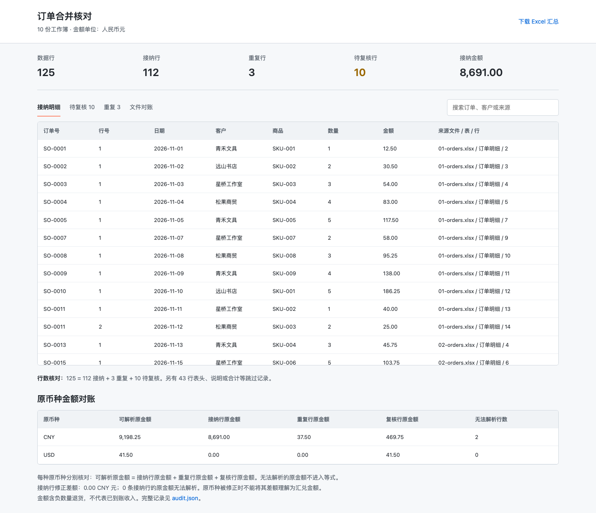

# Excel Merge Audit

[中文](README.md) · [English](README.en.md)

把十份格式不一的订单 Excel，整理成一份能回查原表的汇总。重复、冲突、缺失和格式问题会单独列出，每条记录都能找到来源文件、工作表和行号。

我想用这个小项目回答一个很实际的问题：别人把一堆表交过来，除了把它们拼在一起，能不能把哪些算进去了、哪些没算、为什么没算讲清楚。



## 先看结果

仓库带了十份模拟表，客户和订单都是虚构的。

| 核对项 | 实际结果 |
| --- | ---: |
| 输入文件 | 10 |
| 数据行 | 125 |
| 接纳 | 112 |
| 完全重复 | 3 |
| 待复核 | 10 |
| 接纳金额（CNY 元） | 8,691.00 |

125 = 112 + 3 + 10。另有 43 行表头、空行、说明和合计，保留跳过原因。原金额按币种分别对账，有 2 行无法解析，不会硬凑进金额合计。

- [下载汇总工作簿](demo/output/summary.xlsx)：汇总、明细、待复核、来源四张表。
- [离线报告](demo/output/report.html)：下载仓库后直接打开，可搜索和切换视图。
- [完整审计记录](demo/output/audit.json)：原值、来源哈希、处理去向和错误原因。
- [验证过程](docs/validation.md)：初版、两次迭代和实际检查记录。

## 跑一次

需要 Node.js 22 或更新版本。全部在本机处理，无需账户或 API Key。

```bash
npm ci
npm run demo -- --out outputs/first-demo
```

在 `outputs/first-demo/result/` 打开 `report.html` 或 `summary.xlsx`。演示故意包含异常，因此出现待复核是预期结果。

处理自己的订单表：

```bash
npm run merge -- --input ./my-orders --output ./outputs/run-01
```

输入目录放 `.xlsx` 文件。输出目录必须为空、位于输入目录外。工具读取该目录顶层文件的所有工作表，忽略 Excel 的 `~$` 临时文件，不递归读取子目录。原文件不会被修改。

自动化运行可加 `--fail-on-review`：存在待复核行或表结构问题时，仍导出结果，退出状态码为 `2`。参数或输入错误返回 `1`，正常完成返回 `0`。

## 合并规则

业务场景是人民币订单明细，需要以下十个字段。支持常见中英文别名，完整列表在 [core.mjs](src/core.mjs)。

```text
order_id  line_id  date  customer  sku
quantity  unit_price  amount  currency  status
```

- 表头在前 20 行查找。支持不同列顺序、前置说明，以及中途粘入的新表头。中途表头换列时重新映射；歧义列所在的数据块转复核。
- 唯一键是订单号加明细行号。一单多行会保留。规范化后内容完全相同才去重；同键内容冲突时整组复核。
- 金额用整数分累计，核对“数量 × 单价 = 金额”。零值保留，退款可用负数量，单价不可为负。
- 日期接受明确的 `YYYY-MM-DD`、`YYYY/M/D`、`YYYY年M月D日` 及实际 Excel 日期。`11/12/2026` 这类日期不猜测。
- 状态只接受 `paid`、`refunded`、`cancelled` 及对应别名。非 CNY、缺失值、错误千分位、无法解析的金额均转复核。
- 公式单元格不执行，也不信任缓存值；含公式的行转人工复核。
- 客户按规范化后的文字精确分组，保留大小写区别。Excel 通过明细中的数字分组计算，避免名称中的 `*`、`?` 影响汇总。

工作簿是运行时的结果快照。修改原表后需重跑。汇总金额与客户合计有公式，但编辑明细不会重新执行去重、校验或审计规则。

## 人工修正

每次输出都有 `corrections.template.json`。只保留要修正的记录，填写 `patch` 和 `reason`，删除未使用的空条目。字段名使用上面的英文名称。

```json
[
  {
    "id": "从模板保留原值",
    "sha256": "从模板保留原值",
    "patch": { "date": "2026-11-14" },
    "reason": "核对原始订单后确认日期"
  }
]
```

```bash
npm run merge -- --input ./my-orders --output ./outputs/run-02 --corrections fixes.json
```

修正绑定原行 ID 和文件 SHA-256。旧哈希、未知字段、重复 ID、缺理由会拒绝整次运行。修正后重新执行全部校验和冲突判断，保留原值、改动与理由。

仓库中的 [修正示例](demo/corrections.example.json) 仅对配套模拟表有效：根据生成前的真值修正一条日期和一条客户，接纳从 **112 增到 114**，待复核从 **10 降到 8**。真实业务需要先核对原单，不能照抄示例里的值。

```bash
npm run merge -- --input demo/input --output outputs/corrected --corrections demo/corrections.example.json
```

## 验证与范围

```bash
npm test
npm run verify
```

控制值来自模拟数据生成前的业务真值，合并器不读取 `expected.json`。验证比较分类数量、接纳唯一键、整数金额、逐行归属、输入哈希及发布快照。

目前只支持这类十字段订单 `.xlsx`，不是通用的任意表格识别器。不支持 `.xls`、PDF、OCR、自动汇率转换或公式求值，也没有做大文件性能承诺。标识字段应在源表中存成文本，Excel 已丢失的前导零无法还原。

这次验证说明处理流程可跑通，还没有验证客户是否愿意付费。下一步适合拿一组得到授权的脱敏表，先确认字段和统计口径，再比较结果与人工核对所需时间。

运行依赖为 ExcelJS、JSZip 和 Saxes。当前示例工作簿由制作环境中的 Artifact Tool 生成；它不是运行依赖。MIT License。
